# Temperature Converter - Code Coverage Assignment

This project is part of my in-class assignment about unit testing and code coverage in Java.

The goal was to create a simple temperature converter, write unit tests using JUnit 5, check the code coverage with JaCoCo, and run the project in Jenkins.

## What I implemented

The `TemperatureConverter` class has four methods:

- `fahrenheitToCelsius()` converts Fahrenheit to Celsius.
- `celsiusToFahrenheit()` converts Celsius to Fahrenheit.
- `kelvinToCelsius()` converts Kelvin to Celsius.
- `isExtremeTemperature()` checks if a Celsius temperature is below -40°C or above 50°C.

For Kelvin to Celsius, I used:

C = K - 273.15

For example, 300 K is 26.85°C.

## Testing

I used JUnit 5 to test the temperature conversion methods and the extreme temperature check.

All 4 tests passed successfully.

I created `TemperatureConverterTest` using JUnit 5.

I tested the conversion methods with different values, for example:

- 32°F = 0°C
- 212°F = 100°C
- 0°C = 32°F
- 100°C = 212°F

I also tested the extreme temperature method around the boundary values such as -40°C and 50°C.

This helped me understand why edge cases are important when writing unit tests.

## Code Coverage

I used JaCoCo with Maven to generate the code coverage report.

I ran the tests using:

```bash
mvn clean test
```

The JaCoCo HTML report is generated in:

```text
target/site/jacoco/index.html
```

The report shows line coverage, branch coverage, method coverage, and class coverage.

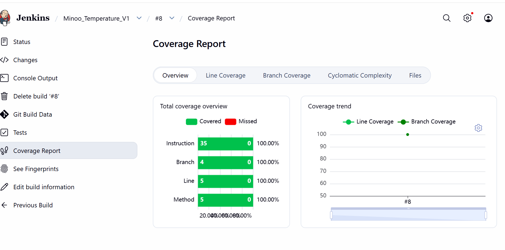

## Test Result

Here is the screenshot of my test results:

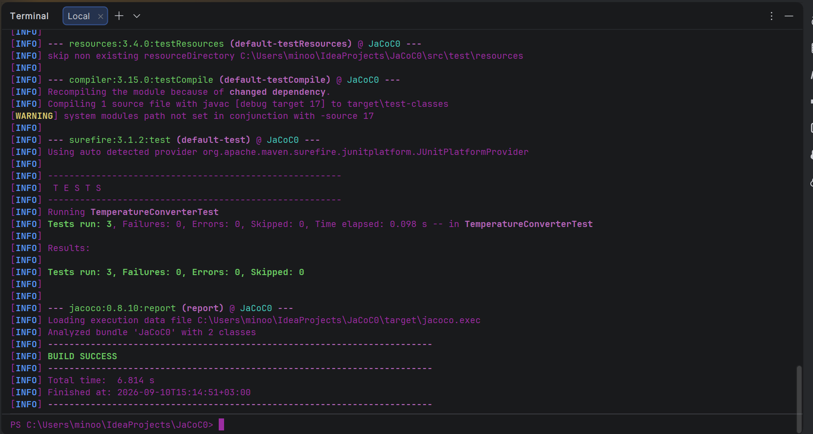

## Jenkins

I created a Jenkins Freestyle project called `Minoo_Temperature_V1`.

Jenkins gets the project from GitHub and runs the Maven tests with:

```text
clean verify
```

The Jenkins build and tests completed successfully.

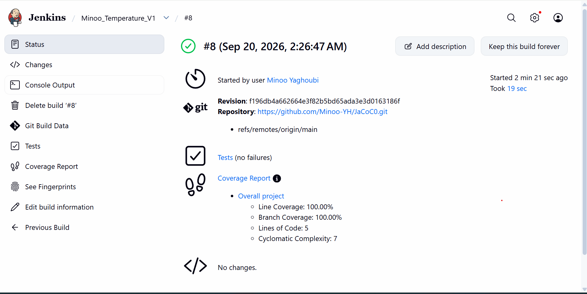

## Jenkins Pipeline

For the next part of the assignment, I created a Jenkins Pipeline for the same Temperature Converter project.

The pipeline includes these stages:

- Build
- Test
- Code Coverage
- Publish Test Results
- Publish Coverage Results
- Docker Build
- Docker Push

The final pipeline completed successfully.

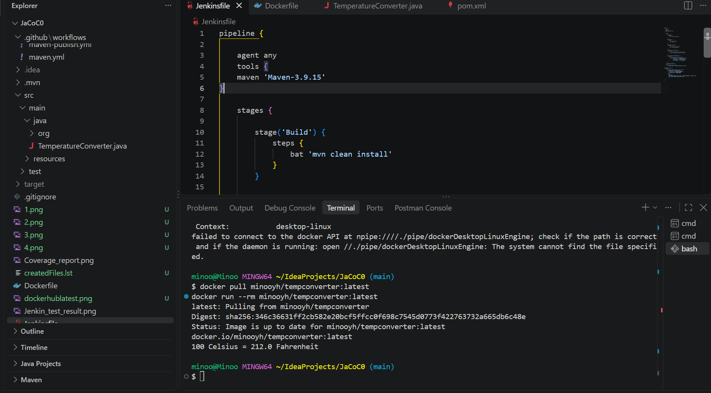

## Docker

I created a Dockerfile for the project and built a Docker image.

The Docker image is:

```text
minooyh/tempconverter:latest
```

The image was also pushed to Docker Hub from the Jenkins pipeline.

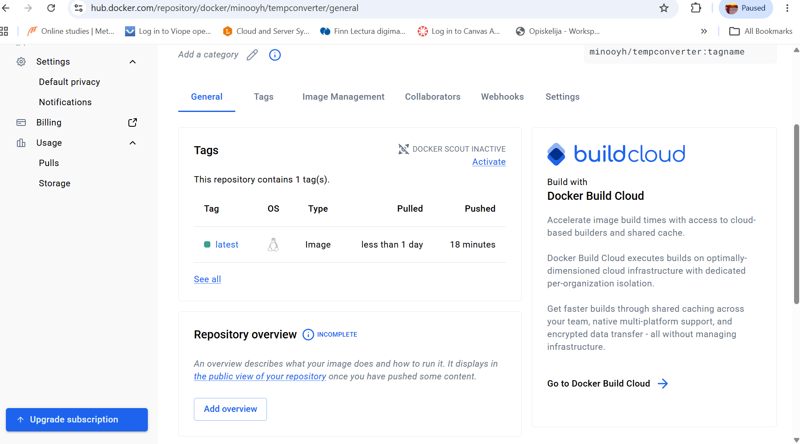

## Running the Docker Image

I pulled the image from Docker Hub using:

```bash
docker pull minooyh/tempconverter:latest
```

Then I ran the image using:

```bash
docker run --rm minooyh/tempconverter:latest
```

The output was:

```text
100 Celsius = 212.0 Fahrenheit
```

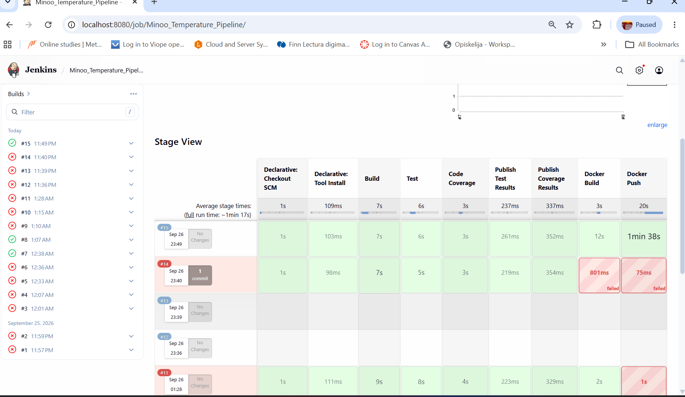

## What I learned

From these assignments, I learned how to write unit tests with JUnit 5 and how to use `assertEquals`, `assertTrue`, and `assertFalse`.

I also learned why testing boundary values is important. For example, -40°C and 50°C are not extreme temperatures in my program, but values below -40°C or above 50°C are.

I learned how to use JaCoCo with Maven to check which parts of my code are covered by my tests.

I also learned how to create a Jenkins pipeline using a Jenkinsfile, build a Docker image, run the image, and push it to Docker Hub.

---

# Assignment 6 - JavaFX, Database and Docker

For this assignment, I continued working on my Temperature Converter project. I changed the console project into a JavaFX application and added an SQLite database. I also added more unit tests and ran the JavaFX application from Docker using Xming.

## JavaFX Temperature Converter

I created a simple JavaFX interface for the Temperature Converter. The user can enter a Celsius value, click the convert button, and see the result in Fahrenheit.

For example, I tested 25 Celsius and the result was 77 Fahrenheit.

## Database

I used SQLite for the database and created two related tables:

- `temperature_unit`
- `temperature_record`

The tables are connected with a foreign key. I used `DBConnection` for the database connection and initialization, and `TempRecordDAO` to save the conversion records.

When I make a conversion in the JavaFX application, the conversion can be saved in the database.

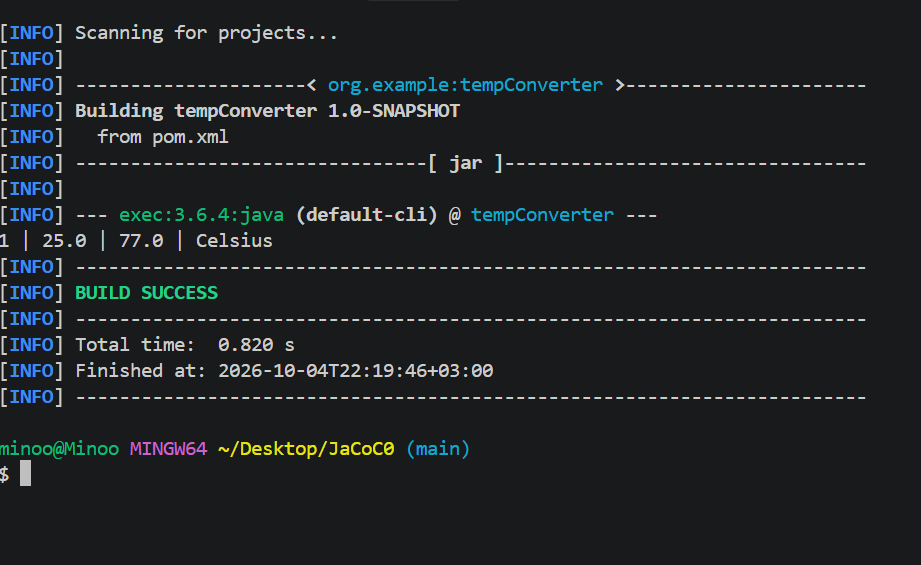

## Unit Tests

I kept my previous unit tests and added new tests for the database classes:

- `DBConnectionTest`
- `TempRecordDAOTest`

The project now has 7 tests in total and all 7 tests pass.

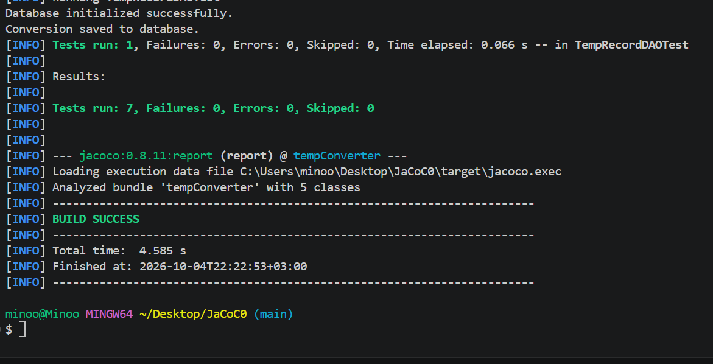

## JaCoCo Code Coverage

I used JaCoCo again after adding the new JavaFX and database classes.

The latest report shows 38% instruction coverage and 66% branch coverage.

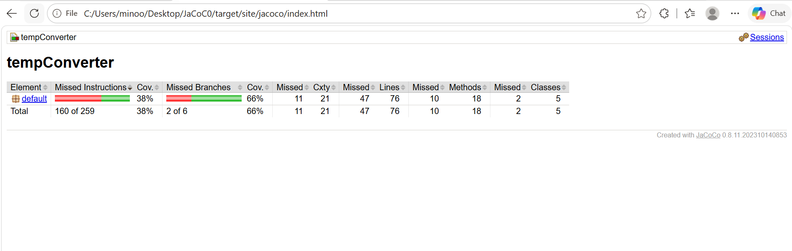

## Docker and Xming

I updated the Dockerfile for the JavaFX application and built the Docker image with:

```bash
docker build -t minooyh/tempconverter:latest .
```

I installed Xming on Windows to use it as the X server. Then I ran the JavaFX application from the Docker container with:

```bash
docker run --rm -e DISPLAY=host.docker.internal:0.0 minooyh/tempconverter:latest
```

The Temperature Converter opened successfully through Xming. I tested it with 25 Celsius and got 77 Fahrenheit.

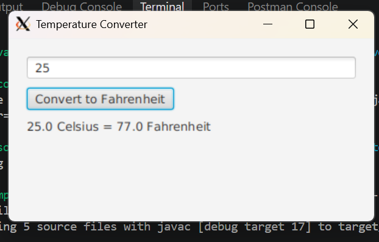

## Docker Hub

After testing the final Docker image, I pushed it to Docker Hub.

The image is:

```text
minooyh/tempconverter:latest
```

I pushed it using:

```bash
docker push minooyh/tempconverter:latest
```

## What I learned from this part

In this assignment, I learned how to make a basic JavaFX GUI and connect a Java application to an SQLite database. I also learned how to save data with a DAO class and add unit tests for database code.

I also learned how to run a JavaFX application inside a Docker container and display the GUI on Windows using Xming.


## JaCoCo Code Coverage

The `TemperatureConverter` class chieved 100% instruction and branch coverage with JaCoCo.

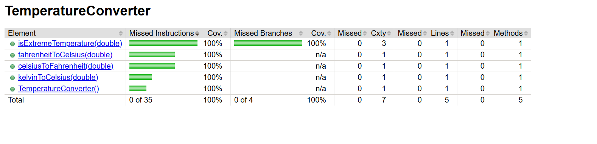


## Localization

The application supports English, Finnish, Swedish, and Japanese.

Example of the application running in Japanese:

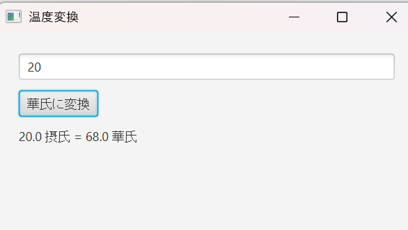

## Assignment 6 - Localization Update

For this assignment, I extended the JavaFX Temperature Converter with localization and unit selection.

The application now supports five languages: English, Finnish, Swedish, Japanese, and Arabic.

### Localization Screenshots

The interface text changes dynamically using FXML, ResourceBundle, and properties files.

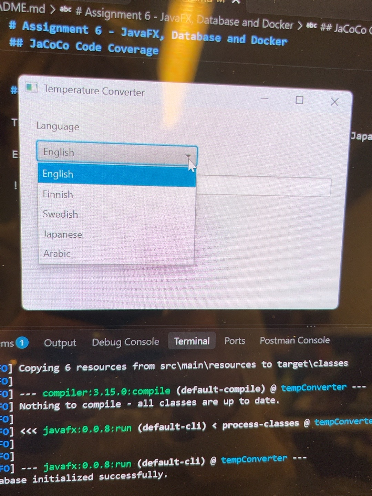

Arabic was added as the fifth supported language:

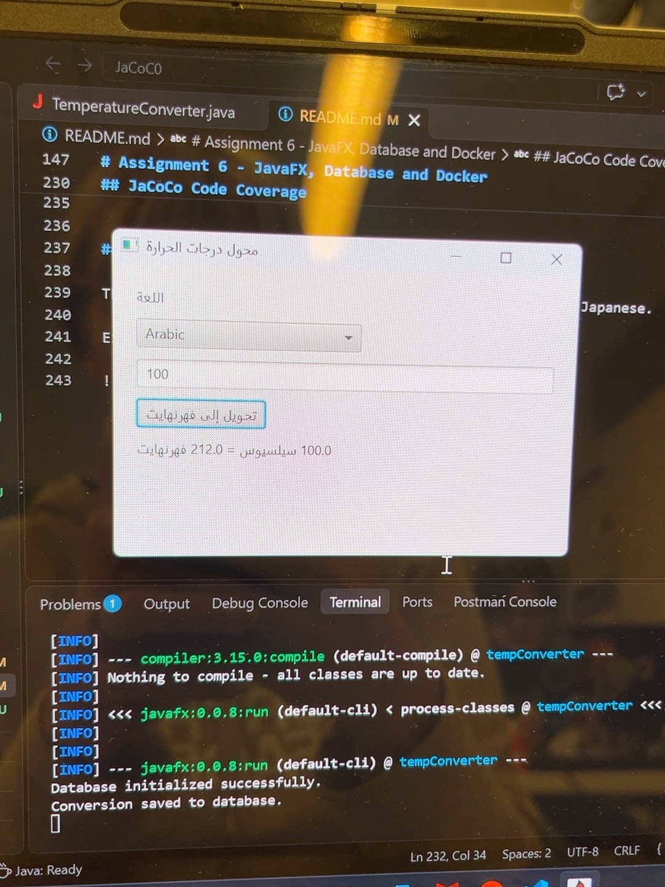

### Temperature Unit Selection

I added an output unit selector to the JavaFX interface. The input is in Celsius and the user can convert it to Fahrenheit, Kelvin, or Celsius.

Example of Fahrenheit conversion:

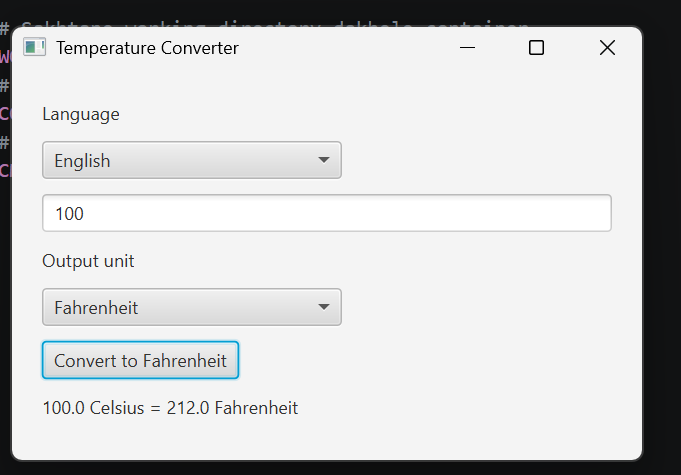

Example with Japanese localization:

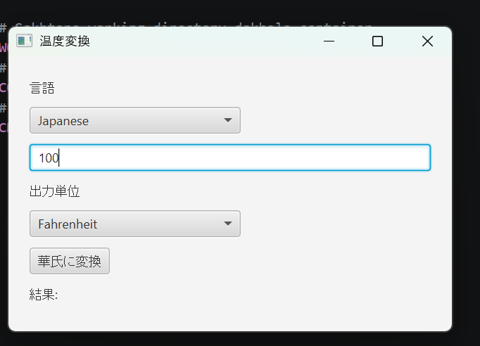

### Updated Unit Tests

I kept all of my previous tests and added a new test for Celsius to Kelvin conversion. The project now has 8 tests in total: 5 TemperatureConverter tests, 2 DBConnection tests, and 1 TempRecordDAO test.

All 8 tests pass successfully with Maven.

```text
Tests run: 8, Failures: 0, Errors: 0, Skipped: 0
BUILD SUCCESS
```

## Kubernetes Deployment

I created a Kubernetes deployment file named `tempconverter.yaml` and tested it locally with Minikube using the Docker driver.

The deployment uses the Docker image `minooyh/tempconverter:latest`.

The Kubernetes pod started successfully with status `Running` and the pod log showed:

```text
Temperature Converter deployed successfully
```

### Jenkins CI/CD

The Jenkins pipeline successfully built and tested the project, generated JaCoCo coverage, built the Docker image, and pushed it to Docker Hub.

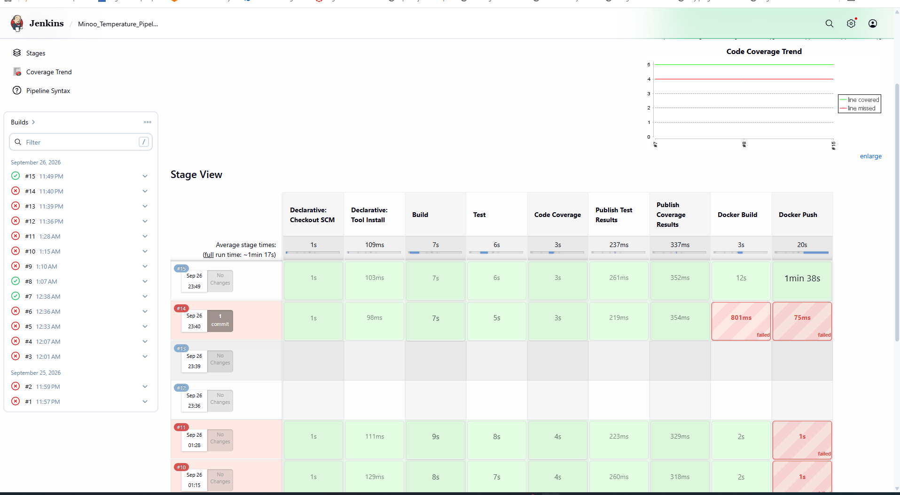

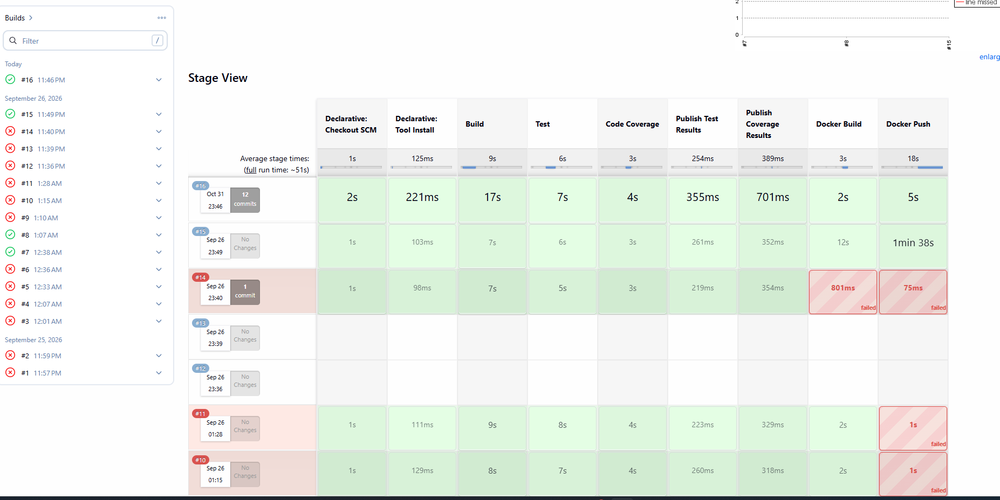

## In-class Assignment 6 — Database Localization

### Purpose

The purpose of this assignment is to extend the Temperature Converter's SQLite database so that measurement units can have localized names and descriptions. The database design also includes unit and conversion-record tables for temperature, speed, distance, and time. The schema and seed data are defined in `src/main/resources/init.sql`, and the production database has been migrated and verified with its existing 22 temperature conversion records preserved.

### Translation Table Approach

This project uses one Translation Table approach for unit localization. Instead of storing a separate translated column or copy of each unit for every language, each unit has one canonical entry and its localized labels are stored as rows in `unit_translation`.

The `measurement_unit` table is the shared unit registry. It contains an integer `id`, a `domain` (`temperature`, `speed`, `distance`, or `time`), and a stable `code`. The existing `temperature_unit` table is preserved and is linked to the shared registry through `temperature_unit_registry`. The speed, distance, and time unit tables use their measurement-unit IDs as foreign keys.

The shared `unit_translation` table contains:

- `unit_id`, a foreign key to `measurement_unit(id)`.
- `lang`, limited by the schema to `en`, `fi`, `sv`, `ja`, or `ar`.
- `name` and `description`, stored as UTF-8 text.
- A composite primary key `(unit_id, lang)`, so each unit has at most one translation per supported language.

The SQL seed data contains localized names and descriptions for the 12 temperature, speed, distance, and time units. The initialization script uses `CREATE TABLE IF NOT EXISTS` and `INSERT OR IGNORE` so repeated initialization does not recreate existing tables or duplicate seeded rows.

### Why Translation Table?

The Translation Table approach keeps localized text separate from stable unit identities and makes adding a language a data change rather than a schema change. It avoids adding one column per language (Field localization), duplicating otherwise identical unit rows by language (Row localization), or creating separate unit tables for each language (Table localization). A shared table also provides the same localization structure for every measurement domain.

### JavaFX and Localization

The JavaFX interface uses the existing `MessagesBundle_*.properties` ResourceBundles for static interface text such as titles, prompts, buttons, and labels. The available bundles are English, Finnish, Swedish, Japanese, and Arabic. The language selector reloads the interface using the selected bundle.

Database localization is a separate layer: `unit_translation` stores the localized names and descriptions for measurement units. The localized-unit DAO reads those values for the active language, with English fallback when a translation is missing. The output-unit selector uses stable unit codes for conversion, while displaying the localized database names. Arabic uses right-to-left node orientation; other supported languages use left-to-right orientation.

### Database Migration and English Fallback

`src/main/resources/init.sql` defines the additive schema and seed data. `DBConnection.initializeDatabase()` loads that resource, enables foreign keys for its connection, and applies the statements transactionally. The database path defaults to `temperature.db` and can be overridden with the `temperature.db.path` system property. Initialization failures are surfaced as an unchecked `IllegalStateException` with the underlying SQL exception as its cause.

The production database migration was run after a verified SQLite backup. Verification confirmed 12 measurement units and 60 translations (12 per language), no duplicate unit keys or translations, no foreign-key violations, and a successful SQLite integrity check. Re-running initialization did not change database rows. The localized-unit DAO uses the requested language and falls back to English when a unit translation is unavailable.

### Tests, Coverage, and Database Integrity

JUnit 5 tests cover temperature conversion, database connection and initialization, record saving, localized unit queries, English fallback, and localized conversion-button labels. Database tests use temporary databases so they do not modify the production `temperature.db`. The latest `mvn clean verify` run completed successfully with 15 tests passing, 0 failures, 0 errors, and 0 skipped.

JaCoCo is configured in Maven to generate a report under `target/site/jacoco/`. The latest test run generated this report; coverage is not a gate for the database migration.

The schema tests check repeatable initialization, translation coverage, UTF-8 sample translations, foreign-key integrity, and preservation of existing temperature records in an isolated test database. The production migration was separately verified to preserve all 22 existing temperature records.

### Docker

The existing Dockerfile builds and starts the JavaFX application with Maven. **Pending:** Docker has not been revalidated with the new database schema, and GUI display still depends on a suitable display environment. The Docker configuration has not been changed for this database-localization step.

### Jenkins

The existing Jenkinsfile defines Maven build and test stages, JaCoCo publishing, and Docker build and push stages. **Pending:** a Jenkins run validating the database-localization changes has not been verified. The Jenkinsfile has not been changed for this step.

### Kubernetes

The existing `tempconverter.yaml` defines a one-replica Deployment. Its container command currently prints a deployment message and sleeps; it does not start the JavaFX application. **Pending:** running the application as a Kubernetes workload and validating it with Minikube are not implemented or verified. The Kubernetes configuration has not been changed for this step.

### Assignment 6 — Localization Screenshots

Static GUI labels are localized using ResourceBundle properties. Unit names and descriptions are localized using SQLite translation tables. Five languages are supported: English, Finnish, Swedish, Japanese, and Arabic. Arabic uses right-to-left layout, and missing unit translations fall back to English.

#### English

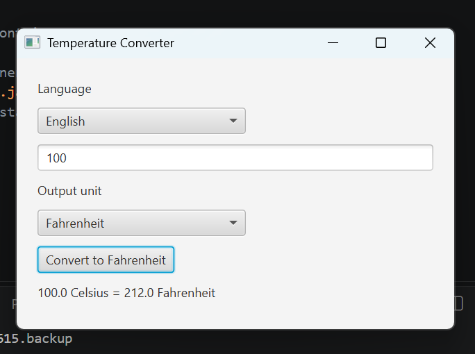

#### Japanese

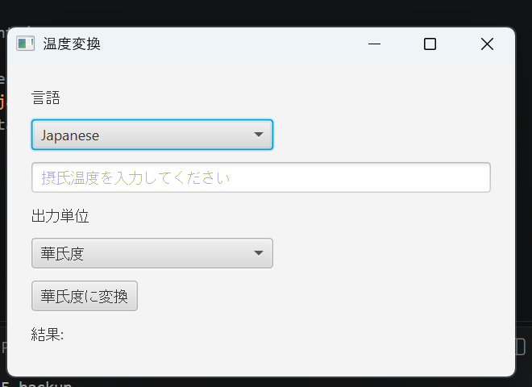

#### Arabic (RTL)

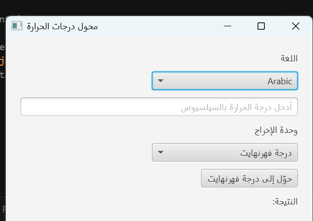

### Other Assignment 6 Screenshots

- Successful Jenkins Pipeline — Pending.
- JaCoCo Coverage Report — Pending.
- Minikube `kubectl get pods` output — Pending.
